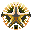

# moh-icons

SVG icons for *Medal of Honor: Allied Assault* and its two expansions.

| Original&nbsp;design | New&nbsp;design | Game | Based on |
|:-:|:-:|---|---|
|  |  | Allied Assault | The Allied star: the star-in-a-circle marking painted on Allied vehicles in WWII |
| |  | Allied Assault (alternative) | The same star with no background, so whatever is behind it shows through the gaps. |
|  |  | Spearhead | The military chevron: three stacked like a sergeant's stripes. The chevrons are curved, like real rank insignia, instead of the original icon's straight ones. |
|  |  | Breakthrough | The US Army Special Forces patch: a dagger crossed by three lightning bolts. |

All three use the same gold (`#B8962E`). Like the Allied star, the Spearhead and Breakthrough emblems break through the gold ring where they reach it. Their backgrounds match the original icons: green `#244C31` for Spearhead and indigo `#2C2564` for Breakthrough.

The originals are the games' 32×32 icons, kept in [`originals/`](originals).
